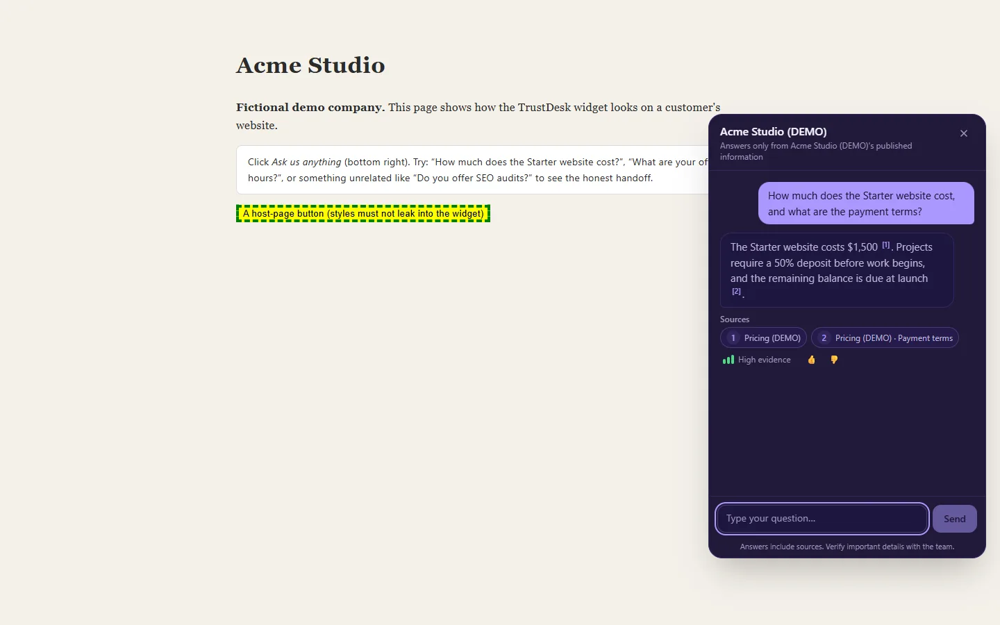
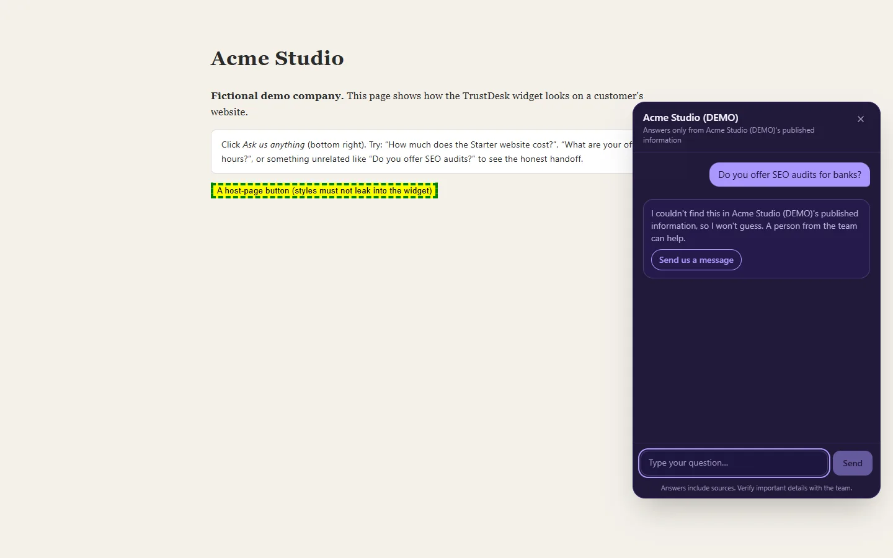
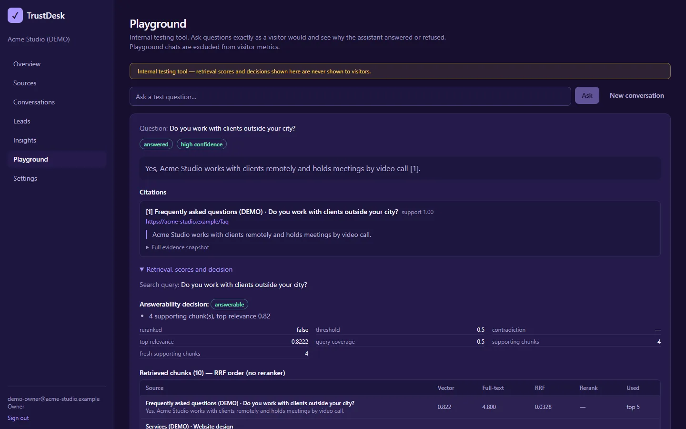
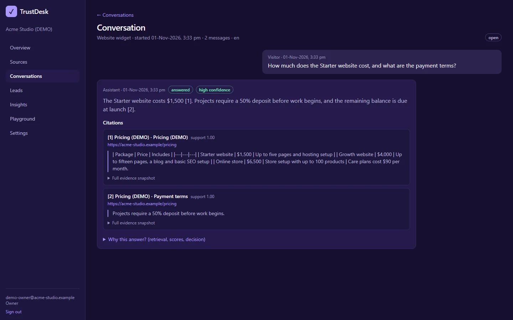

# TrustDesk

**An open-source, self-hostable website assistant that answers only from your approved content.**

> **No source, no answer.** Every factual sentence is cited, every citation is verified server-side, and
> when the evidence isn't there the assistant says so and offers a human instead of guessing.

| Widget: cited answer | Widget: honest handoff |
|---|---|
|  |  |
| **Playground: why it answered** | **Conversation with evidence** |
|  |  |

_Screenshots use the fictional "Acme Studio" demo organization and Google Gemini._

Status: **Phase 1 in progress — not production-ready.** See [What works today](#what-works-today) for an
exact, tested list. Nothing below describes a feature that is not implemented unless it is marked *planned*.

## 5-minute quickstart (local, free, no Docker, no cloud account)

Prerequisites: **Python 3.11+**, **Node.js 20+** (pnpm via `corepack`).

```bash
# 1. Install
cd services/ai
python -m venv .venv
.venv/Scripts/pip install -e ".[dev,localdb]"     # macOS/Linux: .venv/bin/pip …
cd ../..
corepack pnpm install

# 2. Configure (fill TRUSTDESK_APP_DB_PASSWORD, TRUSTDESK_SETUP_TOKEN, TRUSTDESK_ENCRYPTION_KEY)
cp .env.example .env

# 3. Local database (embedded PostgreSQL 16 + pgvector, data in ./data/pg) + schema
cd services/ai
.venv/Scripts/trustdesk db-start
.venv/Scripts/trustdesk db-bootstrap
.venv/Scripts/trustdesk seed-demo        # optional: fictional "Acme Studio" demo org (prints login + key)

# 4. Run everything on ONE port
.venv/Scripts/trustdesk up               # builds on first run; Ctrl+C stops everything
```

Then open:

| URL | What |
|---|---|
| http://localhost:3100 | Admin dashboard (sign in, or run first-time setup at `/setup`) |
| http://localhost:3100/demo | Demo website with the chat widget |
| http://localhost:3100/trustdesk.js | The embeddable widget script |
| http://localhost:3100/v1/… | Public + admin API (proxied to the internal AI service on 127.0.0.1:8000) |

Use `trustdesk up --port 4000` if 3100 is taken. `trustdesk doctor` checks configuration and prints fixes.

### Answer quality in development

With no model configured, `.env` uses the **mock** providers (development only; refused in production).
The mock model quotes the best-matching source sentence verbatim with its citation, so the pipeline is
honest but answers read mechanically. For real answers choose a profile in `.env`:

- **local (free):** install [Ollama](https://ollama.com), `ollama pull llama3.1:8b && ollama pull bge-m3`, set
  `LLM_PROVIDER=ollama`, `EMBEDDING_PROVIDER=ollama`, `EMBEDDING_MODEL=bge-m3`; reranker `none` or `local`
  (`pip install -e ".[local]"`).
- **cloud:** `LLM_PROVIDER=openai|anthropic` with its key; embeddings `openai|cohere`; reranker `cohere`.
- **any OpenAI-compatible endpoint** (Groq, Together, vLLM, LM Studio, Gemini's OpenAI endpoint):
  `LLM_PROVIDER=openai_compat`, `OPENAI_BASE_URL=…`, `OPENAI_API_KEY=…`.

Google Gemini setup: see [docs/providers.md](docs/providers.md#google-gemini-tested-2026-11-01).
Changing the embedding model: run `trustdesk reembed` (builds a new index; the old one serves until it is ready).

## Embed on a website

```html
<script src="https://YOUR-HOST/trustdesk.js" data-tenant="td_pk_…" defer></script>
```

When you self-host a pinned version, add Subresource Integrity: `pnpm --filter @trustdesk/widget build` prints the
`integrity="sha384-…"` value; add it plus `crossorigin="anonymous"` to the tag.

The key is a **publishable** key (not a secret). Add the site's exact origin under **Settings → Allowed widget
origins**; requests from other origins are rejected. The dashboard's Settings page shows the snippet for your
organization.

## Architecture

```
browser ──► :3100 Next.js (dashboard, /trustdesk.js, /demo, proxy /v1/*) ──► 127.0.0.1:8000 FastAPI
                                                                          ├─ LangGraph RAG workflow
                                                                          ├─ indexing worker (same DB queue)
                                                                          └─ PostgreSQL 16 + pgvector (RLS)
```

- `services/ai` — Python: FastAPI, LangGraph, SQLAlchemy, Alembic. All business logic lives here.
- `apps/admin` — Next.js App Router dashboard (backend-for-frontend; no business logic).
- `apps/widget` — React widget in Shadow DOM, built as one self-contained script (~82 KB gzip).
- `packages/contracts` — TypeScript types **generated** from the API's OpenAPI spec; `packages/sdk` — typed client.
- `database/` — migrations and fictional demo seed content.

Decisions, risks and phase plan: [docs/architecture.md](docs/architecture.md). Schema and RLS:
[docs/database.md](docs/database.md).

## What works today

Implemented **and** covered by automated tests (see [docs/testing.md](docs/testing.md)):

- Ingestion: website crawl via sitemap or link crawl (SSRF-safe), PDF and DOCX upload, heading-aware
  chunking (tables/lists kept intact), content hashing, versioning, unchanged-content skip, atomic activation
  (a failed re-index keeps the previous version serving).
- Hybrid retrieval: pgvector + PostgreSQL full-text → Reciprocal Rank Fusion → reranking → top 5.
- Deterministic answerability gate (refuses **before** calling the model), sentence-level citation
  verification (invented numbers/prices, foreign or fabricated citations are removed), HIGH/MEDIUM/LOW
  confidence.
- SSE streaming of verified sentences only; client disconnect cancels generation.
- Tenant isolation: explicit tenant filters + PostgreSQL Row-Level Security (verified with cross-tenant tests).
- Widget: Shadow DOM isolation, streaming, citation chips, confidence meter with explanation, handoff
  (email form with consent + optional Turnstile/hCaptcha, WhatsApp link, booking link), RTL-aware text,
  keyboard support, reduced motion, light/dark themes.
- Dashboard: sign-in, first-run setup, Overview, Sources, Conversations, Leads (+CSV), Insights, Playground
  (retrieval scores, gate decision, verification verdicts), Settings, embed snippet.
- Usage metering and monthly budgets; audit log; rate limiting (Postgres store).

Partially implemented / not yet done: see the *Progress* table in [docs/architecture.md](docs/architecture.md).

## Tests

```bash
cd services/ai && .venv/Scripts/python -m pytest                      # unit + security (no DB)
TRUSTDESK_INTEGRATION=1 .venv/Scripts/python -m pytest tests/integration  # needs the local DB running
corepack pnpm --filter @trustdesk/widget test                         # widget (Vitest + RTL)
corepack pnpm --filter @trustdesk/sdk test
```

## Documentation

[Architecture](docs/architecture.md) · [Database](docs/database.md) · [Security](docs/security.md) ·
[API](docs/api.md) · [Ingestion](docs/ingestion.md) · [Providers](docs/providers.md) ·
[Deployment](docs/deployment.md) · [Testing](docs/testing.md)

## Troubleshooting

| Symptom | Fix |
|---|---|
| Page won't load on the port | Another app uses it: `trustdesk up --port 4000`. |
| Widget shows "unavailable" / 403 in console | Add the page's exact origin in Settings → Allowed widget origins. |
| `DATABASE_URL connects as … bypasses Row-Level Security` | Use the `trustdesk_app` role in `DATABASE_URL` (`trustdesk db-start` writes it). |
| `Psycopg cannot use the 'ProactorEventLoop'` | Run through the `trustdesk` CLI (it selects the right event loop on Windows). |
| Answers are a single quoted sentence | You are on the mock model; configure a real provider (above). |
| "embedding model changed; re-embed required" | You changed `EMBEDDING_*`; restore it or re-index sources. |

## License

[Apache-2.0](LICENSE). Telemetry: **none** (off by default; nothing is collected).
