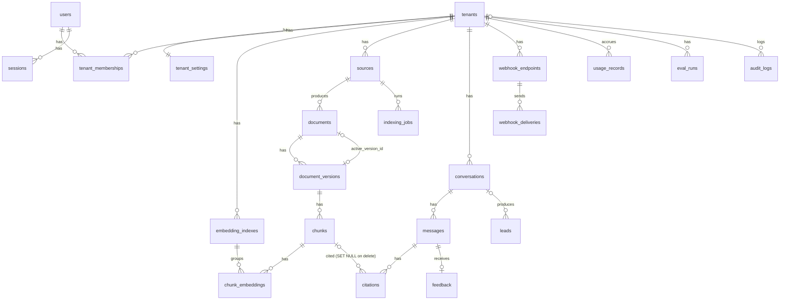

# TrustDesk — Database Schema

Status: **Migration written** (`database/migrations/versions/0001_initial_schema.py`); verified against a
live database only once the integration tests have run. PostgreSQL 15+ + `pgvector` ≥ 0.7 + `pgcrypto` +
`citext`. All objects live in the **`trustdesk` schema**, not `public`: Supabase exposes `public` through
its REST API to the anon key, and `users`/`sessions` are not tenant-scoped. All timestamps are `timestamptz` stored in UTC. All primary keys
are `uuid DEFAULT gen_random_uuid()` unless noted.

## Relationships



## Tables

Notation: `→ t` = foreign key to `t(id)`. Every table marked **[T]** has `tenant_id uuid NOT NULL → tenants
ON DELETE CASCADE`, RLS enabled, and an index leading with `tenant_id`.

### Identity & tenancy

**tenants** — `slug citext UNIQUE`, `name text`, `public_key text UNIQUE` (publishable widget key,
`td_pk_…`, not a secret), `status` (`active|suspended`), `is_demo bool`, `created_at`, `updated_at`.

**users** (global, not tenant-owned; one person may administer several tenants in platform mode) —
`email citext UNIQUE`, `password_hash text` (argon2id), `display_name`, `is_active bool`,
`last_login_at`, `created_at`.

**tenant_memberships** **[T]** — `user_id → users CASCADE`, `role` (`owner|admin`), `created_at`.
`UNIQUE (tenant_id, user_id)`. A partial unique index guarantees at least the shape "one owner" is
checkable; the "never remove the last owner" rule is enforced in the service.

**sessions** — `user_id → users CASCADE`, `token_hash bytea UNIQUE` (SHA-256 of the cookie token),
`active_tenant_id → tenants`, `expires_at`, `last_seen_at`, `ip_hash bytea`, `user_agent text`,
`created_at`. Index `(expires_at)` for cleanup.

**tenant_settings** **[T]** (PK = `tenant_id`) — `schema_version int`, `organization_name`,
`description`, `industry`, `audience`, `website_urls text[]`, `allowed_domains text[]` (crawl allowlist),
`allowed_origins text[]` (widget CORS; wildcard `*` rejected by CHECK and by validation),
`founder_name`, `founder_role`, `default_language`, `enabled_languages text[]`, `timezone`,
`llm_provider`, `llm_model`, `reranker_provider`, `confidence_threshold numeric(4,3)`,
`max_answer_tokens int`, `monthly_budget_usd numeric(12,2)`, `budget_warning_pct smallint`,
`budget_hard_limit bool`, `retention_days int NULL`, `greeting text`, `widget_theme jsonb` (colors, logo,
font — free-form presentation data), `handoff_channels jsonb` (per-channel plugin config; secrets inside
are encrypted with `TRUSTDESK_ENCRYPTION_KEY`), `setup_completed_at`, `updated_at`.

**embedding_indexes** **[T]** — `provider`, `model`, `dimension smallint CHECK (dimension IN
(384,768,1024,1536))`, `status` (`building|active|retired`), `created_at`, `activated_at`.
Partial `UNIQUE (tenant_id) WHERE status = 'active'`.

### Knowledge

**sources** **[T]** — `kind` (`website|sitemap|upload`), `root_url text NULL`, `include_patterns
text[]`, `exclude_patterns text[]`, `max_pages int`, `enabled bool`, `tags text[]`, `created_by → users
SET NULL`, `last_crawled_at`, `created_at`, `updated_at`.

**documents** **[T]** — `source_id → sources CASCADE`, `source_type` (`web_page|pdf|docx`),
`canonical_url text NULL`, `storage_key text NULL` (uploaded file), `title`, `language`, `tags text[]`
(validated set: `case-study|founder|pricing|faq`, extensible), `enabled bool`, `status`
(`pending|crawling|parsing|chunking|embedding|indexed|failed|stale`), `last_error text`,
`active_version_id → document_versions NULL` (`DEFERRABLE INITIALLY DEFERRED`), `created_at`,
`updated_at`.
Indexes: `(tenant_id, status)`, `UNIQUE (tenant_id, canonical_url) WHERE canonical_url IS NOT NULL`,
GIN `(tags)`.

**document_versions** **[T]** — `document_id → documents CASCADE`, `version_no int`,
`content_hash char(64)` (SHA-256 of normalized text), `state` (`building|active|superseded|failed`),
`title`, `source_last_modified`, `fetched_at`, `byte_size int`, `raw_storage_key`, `metadata jsonb`
(parser output such as PDF author/page count), `error text`, `created_at`, `activated_at`.
`UNIQUE (document_id, version_no)`, index `(document_id, content_hash)`, index `(tenant_id, state)`.

**chunks** **[T]** — `document_id → documents CASCADE`, `document_version_id → document_versions
CASCADE`, `ordinal int`, `content text`, `token_count int`, `content_hash char(64)`, `source_url`,
`page_title`, `section text`, `heading_path text[]`, `parent_section_id text` (stable slug of the
enclosing heading), `page_number int NULL`, `language`, `tsv_config regconfig` (`english` for en,
`simple` otherwise), `tsv tsvector GENERATED ALWAYS AS (setweight(to_tsvector(tsv_config,
coalesce(page_title,'') || ' ' || coalesce(section,'')), 'A') || setweight(to_tsvector(tsv_config,
content), 'B')) STORED`, `created_at`.
Indexes: `UNIQUE (document_version_id, ordinal)`, GIN `(tsv)`, `(tenant_id, document_version_id)`,
`(content_hash)`.

**chunk_embeddings** **[T]** — PK `(chunk_id, embedding_index_id)`; `chunk_id → chunks CASCADE`,
`embedding_index_id → embedding_indexes CASCADE`, `dimension smallint`, `embedding vector` (untyped).
Indexes, one per supported dimension:
`CREATE INDEX … USING hnsw ((embedding::vector(1024)) vector_cosine_ops) WHERE dimension = 1024;`
(same for 384, 768, 1536). Queries must use the identical cast and `WHERE dimension = :d` to hit the index.

**indexing_jobs** **[T]** — `source_id → sources CASCADE`, `document_id → documents CASCADE NULL`,
`kind` (`crawl|ingest_file|reindex|reembed`), `status` (`pending|crawling|parsing|chunking|embedding|
indexed|failed|stale`), `progress jsonb` (`{found, processed, skipped_unchanged, failed}`),
`error_code text`, `error_message text` (sanitized, admin-facing), `attempts smallint`,
`locked_by text`, `locked_at`, `started_at`, `finished_at`, `created_at`.
Index `(status, created_at) WHERE status = 'pending'` for `SKIP LOCKED` claiming.

### Conversations

**conversations** **[T]** — `visitor_id uuid` (random, anonymous, generated by the widget),
`channel` (`widget|playground`), `language`, `status` (`open|handed_off|closed`),
`page_url text NULL`, `page_title text NULL` (context only, never evidence), `message_count int`,
`started_at`, `last_message_at`. Indexes `(tenant_id, last_message_at DESC)`, `(tenant_id, status)`.

**messages** **[T]** — `conversation_id → conversations CASCADE`, `role` (`user|assistant`),
`content text`, `rewritten_query text NULL`, `language`, `answer_status`
(`answered|partial|refused|handoff|error`) NULL for user rows, `confidence` (`high|medium|low`) NULL,
`handoff_required bool`, `handoff_summary text`, `prompt_version text`, `llm_provider`, `llm_model`,
`input_tokens int`, `output_tokens int`, `latency_ms int`, `request_id text`, `trace_id text`,
`retrieval_trace jsonb` (candidates, RRF/rerank scores, gate signals — powers Playground and gap
reports), `tsv tsvector GENERATED (simple, content) STORED`, `created_at`.
Indexes `(conversation_id, created_at)`, `(tenant_id, created_at)`, `(tenant_id, confidence)`, GIN `(tsv)`.

**citations** **[T]** — `message_id → messages CASCADE`, `marker smallint` (1–5),
`chunk_id → chunks SET NULL` (chunk may be deleted later; snapshot remains), `document_version_id →
document_versions SET NULL`, `source_url`, `page_title`, `section`, `evidence_snapshot text` (full chunk
text at answer time), `supporting_span text`, `support_score real`, `source_updated_at`, `created_at`.
`UNIQUE (message_id, marker)`.

**feedback** **[T]** — `message_id → messages CASCADE UNIQUE`, `rating` (`helpful|not_helpful`),
`comment text NULL` (length-limited), `created_at`.

**leads** **[T]** — `conversation_id → conversations SET NULL`, `channel`
(`email|whatsapp|booking|slack|telegram|webhook`), `name`, `email citext`, `phone`, `message text`,
`summary text`, `source` (`widget|playground|api`), `status` (`new|contacted|qualified|closed|spam`),
`idempotency_key text`, `consented_at`, `created_at`, `updated_at`.
`UNIQUE (tenant_id, idempotency_key)` prevents duplicate submissions; indexes `(tenant_id, status,
created_at DESC)`.

### Integrations, cost, audit

**webhook_endpoints** **[T]** — `url text` (SSRF-validated), `secret_encrypted bytea`, `events text[]`,
`enabled bool`, `created_at`.

**webhook_deliveries** **[T]** — `endpoint_id → webhook_endpoints CASCADE`, `event`, `payload jsonb`,
`status` (`pending|delivered|failed|dead`), `attempts smallint`, `next_attempt_at`, `last_status_code`,
`last_error`, `created_at`. Index `(status, next_attempt_at) WHERE status = 'pending'`.

**usage_records** **[T]** — `kind` (`llm|embedding|rerank`), `provider`, `model`, `input_tokens int`,
`output_tokens int`, `units int` (documents reranked / texts embedded), `estimated_cost_usd
numeric(12,6)`, `message_id → messages SET NULL`, `request_id`, `occurred_at`.
Index `(tenant_id, occurred_at)`; monthly totals via `date_trunc('month', occurred_at)`.

**rate_limit_buckets** (UNLOGGED, Postgres rate-limit store) — PK `(bucket_key, window_start)`, `count int`.
Keys are hashed (`tenant:ip-hash:route`), never raw IPs.

**eval_runs** **[T]** — `dataset text`, `status`, `prompt_version`, `config jsonb`, `metrics jsonb`,
`faithfulness numeric(4,3)`, `started_at`, `finished_at`. (Table in P1; runner in P3.)

**audit_logs** — `id bigint GENERATED ALWAYS AS IDENTITY`, `tenant_id → tenants SET NULL NULL`,
`actor_user_id → users SET NULL`, `action text`, `target_type`, `target_id`, `request_id`,
`ip_hash bytea`, `metadata jsonb` (never credentials), `created_at`. Runtime role gets `INSERT, SELECT`
only — no `UPDATE/DELETE`.

## Row-Level Security

Roles (created by `database/init/`):

| Role | Use | Attributes |
|---|---|---|
| migration user (`DIRECT_DATABASE_URL`, e.g. `postgres`) | Alembic migrations; owns tables and the `SECURITY DEFINER` functions | table owner, therefore not subject to RLS |
| `trustdesk_app` (`DATABASE_URL`) | API + worker at runtime | `LOGIN NOSUPERUSER NOBYPASSRLS`, DML only, no DDL, no `UPDATE/DELETE` on `audit_logs` |

Policy on every **[T]** table:

```sql
ALTER TABLE x ENABLE ROW LEVEL SECURITY;   -- not FORCE: the owner must bypass for definer functions
CREATE POLICY tenant_isolation ON x
  USING      (tenant_id = NULLIF(current_setting('app.tenant_id', true), '')::uuid)
  WITH CHECK (tenant_id = NULLIF(current_setting('app.tenant_id', true), '')::uuid);
```

Missing setting → `NULL` → zero rows (fail closed). The app sets it per transaction with
`set_config('app.tenant_id', :tenant, true)`.

Cross-tenant operations go through `SECURITY DEFINER` functions owned by the migration user, each with a
fixed `search_path` and a single narrow purpose (EXECUTE revoked from `PUBLIC`, granted to `trustdesk_app`):

- `resolve_public_key(key) → (tenant_id, status)` — widget requests
- `user_memberships(user_id) → (tenant_id, tenant_name, role)` — login and tenant switcher
- `count_users()` — first-run Setup Wizard detection
- `claim_indexing_job(worker)` / `claim_webhook_delivery(worker)` — `FOR UPDATE SKIP LOCKED` claim;
  the worker then sets `app.tenant_id` to the returned tenant before touching data.

Threat model: RLS here is defence in depth against **application bugs** (a query missing its tenant
filter). It is not a boundary against a fully compromised `trustdesk_app` connection, which can set
`app.tenant_id` itself. Session lookup does not need a definer function because `sessions` is keyed by the
token hash and is not tenant-owned.

`users`, `sessions` and `rate_limit_buckets` are not tenant-owned; the runtime role reaches them only via the
service's auth module.

## Retention & deletion

Deleting a tenant cascades to all tenant data. Deleting a document cascades to versions, chunks and
embeddings; citations keep their `evidence_snapshot` (chunk FK set NULL) so past answers remain
auditable. `retention_days` (P3 automation) deletes conversations and their messages/citations/feedback.
